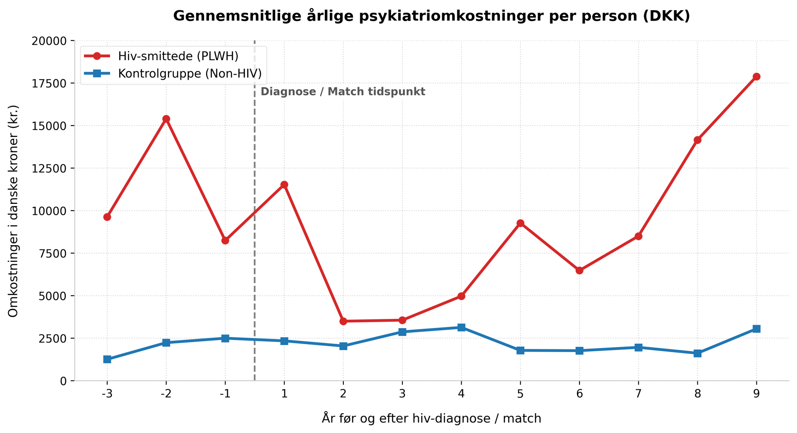
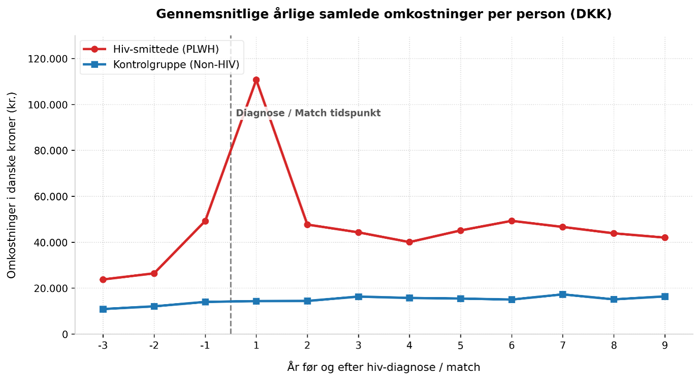

# health-data-visualizations
Dette projekt indeholder Python-scripts kodet med matplotlib til at visualisere registerdata omkring hiv-smittede personer (PLWH) i Danmark. Graferne viser: Gennemsnitlige årlige psykiatriomkostninger per person. • Gennemsnitlige årlige samlede sundhedsomkostninger per person, som viser et markant spring i år 1 efter diagnosen.
markdown
# HIV Sundhedsøkonomisk Dataanalyse

Dette projekt indeholder Python-scripts kodet med `matplotlib` til at analysere og visualisere registerdata omkring hiv-smittede personer (PLWH) i Danmark. Projektet fokuserer på de gennemsnitlige årlige omkostninger per person i årene før og efter diagnosetidspunktet.

## Visualiseringer

### 1. Gennemsnitlige årlige psykiatriomkostninger per person (DKK)
Grafen viser et markant spring i psykiatriomkostningerne i årene op til og umiddelbart efter hiv-diagnosen.

### 2. Gennemsnitlige årlige samlede omkostninger per person (DKK)
Grafen visualiserer de samlede sundhedsomkostninger og fremhæver det voldsomme peak i det første år efter diagnosetidspunktet.

## Kildehenvisning (Data Source)
Data anvendt i dette projekt stammer fra følgende videnskabelige undersøgelse:

* Ehlers, L. H., Axelsen, F., Bøjer Rasmussen, T., Dollerup, J., Jespersen, N. A.
